# Oreo handbook

How to build Oreo, flash its firmware, set up its servos, and work on the code.

Oreo is a small four-legged desk robot built around an ESP32-S3 camera board. It walks with eight MG90S servos,
looks around with a pan/tilt head, shows its face on a 2" display, hears through a MEMS mic, talks through a
small speaker, and sees with the camera plus a single-beam time-of-flight sensor.

1. [Parts](#1-parts)
2. [Print the parts](#2-print-the-parts)
3. [Assembly](#3-assembly)
4. [Wiring](#4-wiring)
5. [Flash the firmware](#5-flash-the-firmware)
6. [First start](#6-first-start)
7. [Servo mapping and calibration](#7-servo-mapping-and-calibration)
8. [The SD card](#8-the-sd-card)
9. [Developing Oreo](#9-developing-oreo)
10. [Troubleshooting](#10-troubleshooting)

---

## 1. Parts

| Qty | Part | Notes |
|---|---|---|
| 1 | ESP32-S3 WROOM CAM board, **N16R8** (16 MB flash, 8 MB PSRAM) | with OV2640 camera and microSD slot (Freenove-style pinout) |
| 1 | 2.0" IPS display, ST7789, 240×320, SPI | the face |
| 1 | PCA9685 16-channel servo board | I2C 0x40 |
| 10 | MG90S micro servos (metal gear, 180°) | 8 legs + head pan + head tilt |
| 1 | MPU6050 (GY-521) | balance / fall detection, I2C 0x68 |
| 1 | VL53L0X (GY-530) | distance sensor on the head, I2C 0x29 |
| 1 | 0.96" OLED, SSD1306, 128×64, I2C | status screen in the chest, 0x3C |
| 1 | MAX98357A I2S amplifier | |
| 1 | Speaker, 8 Ω, 0.5 W, round, 40 mm | fits the round opening in the head's side; the amp can give ~1.4 W at 5 V, so keep the volume moderate |
| 1 | INMP441 I2S MEMS microphone | |
| 1 | TTP223 touch pad | on the crown of the head |
| 1 | 2S LiPo, 7.4 V 1000 mAh 30C (drone battery, XT30) | |
| 1 | 2S BMS, 20 A (HW-391) | pads: 0V = B-, 4.2V = balance middle, 8.4V = B+, (+)/(-) = output and charging |
| 1 | USB-C 2S boost charger board (8.4 V, 2 A) | GND pad = battery -, BAT pad = battery +; OK LED green = full, CR red = charging |
| 1 | XL4015 buck converter | servo power, set to 5.6 V |
| 1 | MP1584 mini buck converter (3 A, 22×17 mm) | logic power, set to 5 V; its IN/OUT pad names are printed on the back |
| 1 | Rocker switch (small, ~19×13 mm) | |
| 2 | Resistors 100 kΩ and 10 kΩ | battery voltage divider |
| 1 | microSD card (any size, FAT32) | face sounds, wake word, memories |
| ~50 | M2 self-tapping screws, 4–8 mm (an assorted M2 kit is easiest) – see *Screws* below | 42 are used |
| – | Silicone wire (22–26 AWG), Dupont jumpers, heat-shrink | |

## 2. Print the parts

The easiest start: **`hardware/Oreo_all_parts.3mf`** – all 22 printed parts, laid out for a 256 × 256 mm bed
(Bambu Lab A1 / P1 / X1) on four named plates: **1 Body**, **2 Legs**, **3 Head**, **4 Neck**. Each part already lies on
the side that needs the least support. Other slicers open it too (as one plate – use *Arrange*).

The same parts are in `hardware/assembly_parts/` as STL files, one per part, **in their assembled position** (so they
also line up when you open them all together). Before slicing those, lay each one on its flattest face.

The full CAD is **`hardware/Oreo(sesame_remixed).f3d`** – open it in Autodesk Fusion (File → Open → Open from my
computer) to change a part. It also holds the original Sesame robot (the orange one) for comparison, and a second
copy of the head lying where it was modelled – the head's sketches sit on that copy.
PLA or PETG, 0.2 mm layers, 3 walls, 15–20 % infill. The servos press into their pockets and the shells clip on.

| Part | Count |
|---|---|
| Middle block (chassis), chassis trim | 1 each |
| Top shell | 1 |
| Bottom cover | 1 |
| Femur | 4 |
| Foot | 4 |
| Neck base, pan bracket, tilt plate | 1 each |
| Head shell, front plate, bezel, side plate | 1 each |
| Chest strips (left, right) and back plate – black, 1 mm, glued on the top shell like the head's strips | 1 each |

The `*_servo` files are the servos themselves (the 9 g size: MG90S / SG90), there for reference – don't print them.


### Screws

Every screw is **M2 self-tapping** (pan or flat head, Phillips): the printed parts have ~1.5 mm pilot holes for the
thread to bite into and ~2.3 mm clearance holes in the part on top. Counted from the CAD:

| Where | Screws | Length |
|---|---|---|
| Hip servos into the middle block (2 ears each) | 8 | M2 × 8 |
| Knee servos into the femurs (2 ears each) | 8 | M2 × 8 |
| Feet onto the knee servos | 8 | M2 × 6 |
| Head front plate onto the head shell | 6 | M2 × 6 |
| Bottom cover onto the middle block | 4 | M2 × 8 |
| Top shell onto the middle block | 4 | M2 × 4 |
| Tilt servo into the neck's top plate (its 2 ears) | 2 | M2 × 5 |
| The two neck arms' feet, together | 2 | M2 × 5 |
| **Total** | **42** | |

Each servo also comes with a small screw that holds its horn on the shaft – use those (10). Don't overtighten the
self-tapping screws: the thread is cut into plastic and strips if forced.

## 3. Assembly

Do the wiring (section 4) as you go: it is much easier to solder the power boards before they go into the chest.
**Don't screw the servo horns on tight until the servos are calibrated (section 7)**.

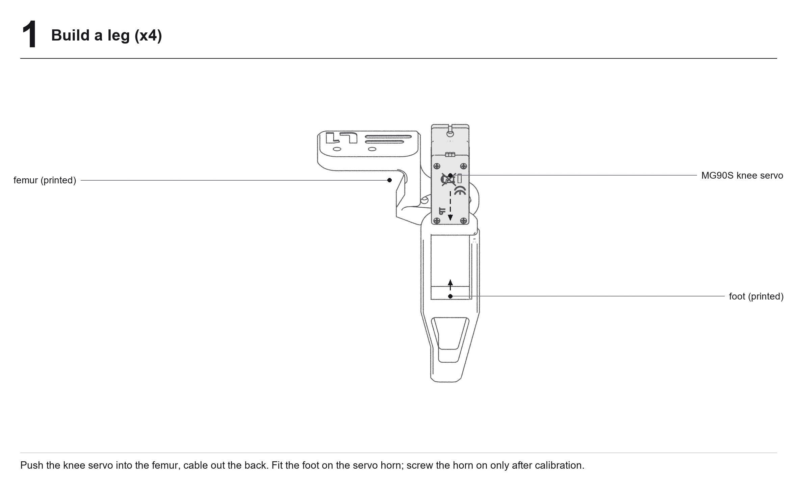
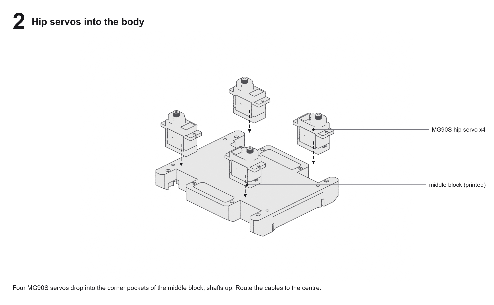
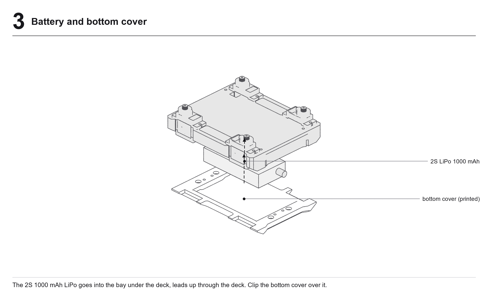
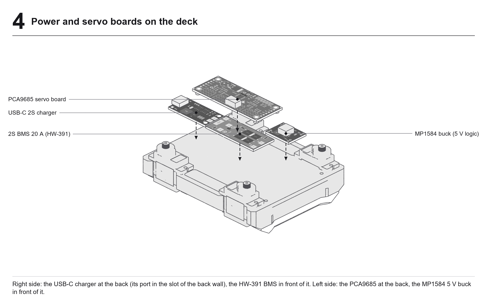
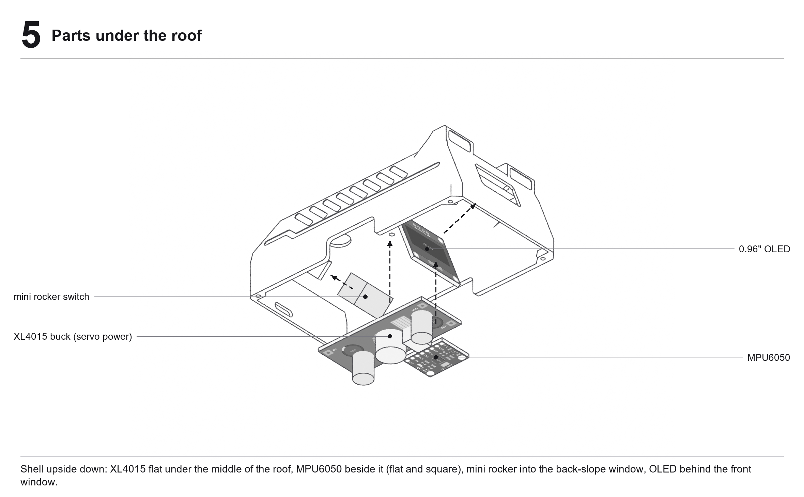
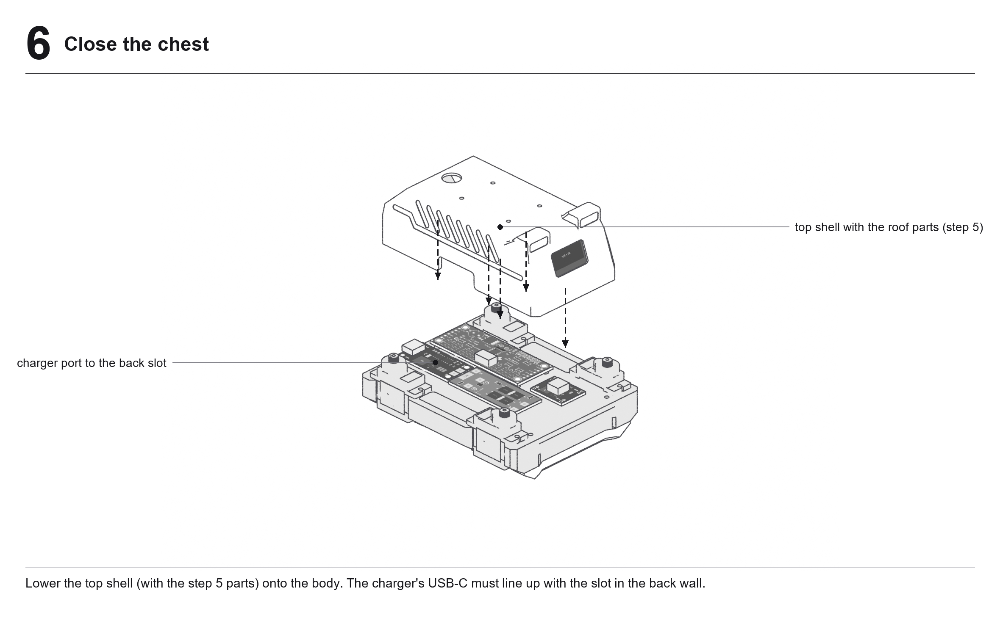
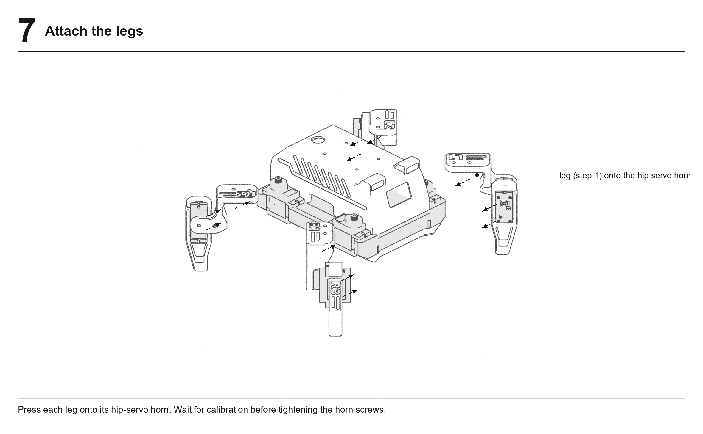
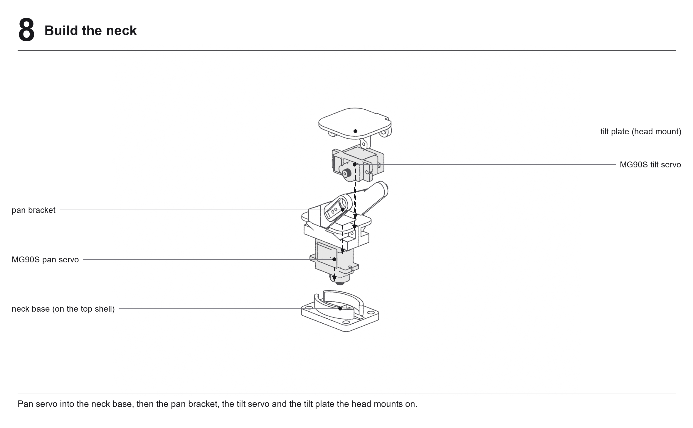
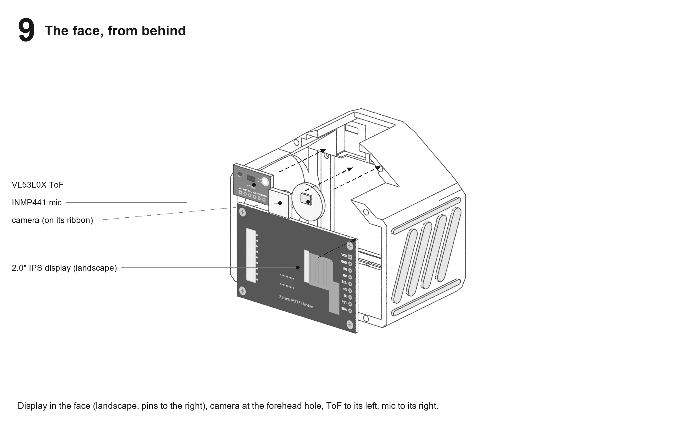
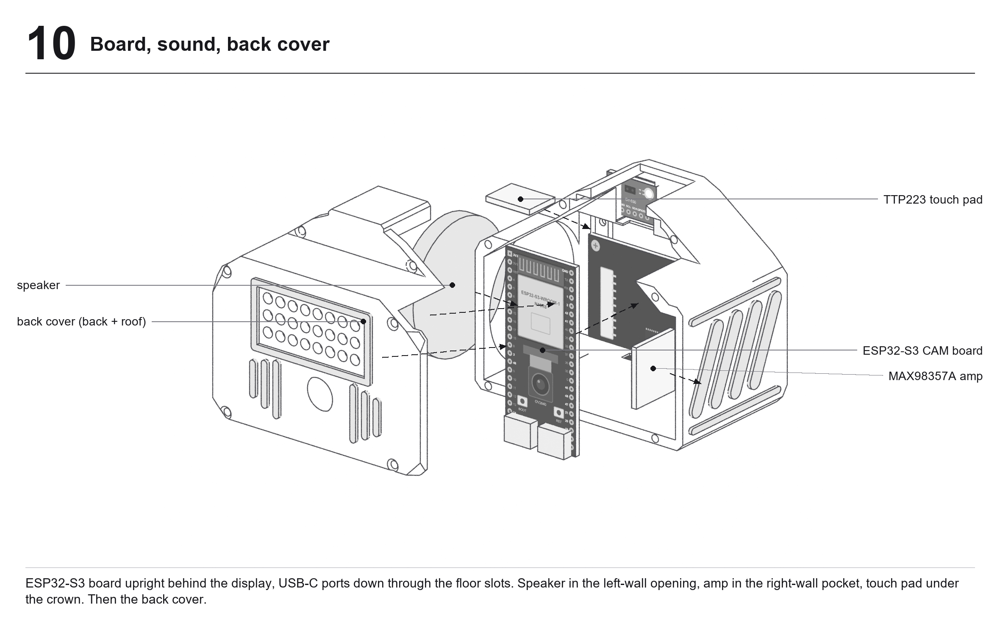
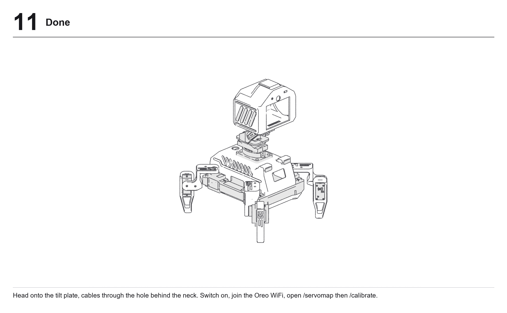

Where things sit (left/right as the robot sees it, its face is the front):

* **Chest, under the deck:** the battery, in the bay of the middle block, closed by the bottom cover.
* **Chest, on the deck:** right side – the USB-C charger at the back (its port in the slot of the back wall) and the
  green HW-391 BMS in front of it; left side – the PCA9685 at the back and the MP1584 5 V buck in front of it.
* **Chest, under the roof:** the XL4015 flat in the middle, the MPU6050 beside it (mount it flat and square – it is
  the robot's sense of level), the mini rocker switch in the window of the back slope, the OLED behind the window of
  the front face. The round hole in the roof behind the neck is the cable way to the head.
* **Head:** the head is a front body (face, side walls, floor) closed by an L-shaped back cover (back + roof).
  The display sits landscape in the face; the camera looks out of the forehead hole with the ToF sensor on its
  left and the mic on its right. The ESP32-S3 board stands upright right behind the display, its two USB-C ports
  down through the slots in the floor and its top edge in the slot under the roof. The speaker fits the round
  opening in the left wall, the MAX98357A amp the pocket in the right wall, the touch pad under the roof.

## 4. Wiring

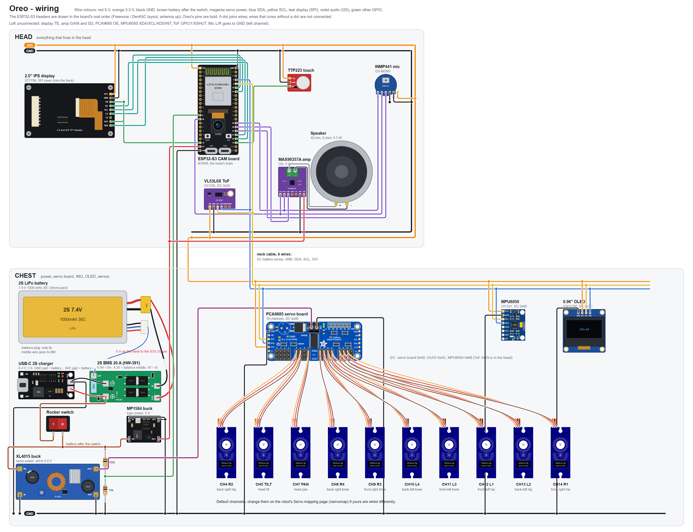

([SVG version](docs/img/wiring.svg) – zoom in as far as you like.)

### Pin table (ESP32-S3)

| GPIO | Goes to |
|---|---|
| 1 | I2C SDA – PCA9685, MPU6050, VL53L0X, OLED |
| 2 | I2C SCL – same four |
| 3 | battery sense: middle of the 100 k / 10 k divider (switched pack + → 100 k → GPIO3 → 10 k → GND) |
| 14 | display EN (backlight) **and** display RST, joined |
| 19 | TTP223 I/O |
| 20 | display DC |
| 21 | display CS |
| 41 | display SDA (MOSI) |
| 42 | display SCL (SCLK) |
| 45 | I2S bit clock – amp BCLK and mic SCK |
| 46 | I2S word select – amp LRC and mic WS |
| 47 | mic SD (data in) |
| 48 | amp DIN (data out) |
| camera | fixed on the board: XCLK 15, SIOD 4, SIOC 5, D0–D7 11 9 8 10 12 18 17 16, VSYNC 6, HREF 7, PCLK 13 |
| microSD | fixed on the board (SD_MMC 1-bit: CLK 39, CMD 38, D0 40) |

### Power

```
2S LiPo ── BMS (0V, 4.2V, 8.4V) ── BMS (+)/(-) ── USB-C charger (charges through the BMS)
                                 │
                            rocker switch
                                 │  VSW (7.4 V nominal, 8.4 V full)
              ┌──────────────────┼──────────────────────┐
         XL4015 buck        MP1584 buck (5 V)      100k/10k divider → GPIO3
       (5.6 V, servos)      (logic: ESP32 5V pin, amp)
              │
       PCA9685 V+ terminal → servos
```

* **Set the XL4015 output to 5.6 V with a multimeter before you connect the servos.** 5.6 V (rather than 5 V) gives
  the MG90S servos extra torque while staying inside their 4.8–6 V range. The battery's 7–8.4 V straight on the servos
  will kill them.
* The MP1584 5 V buck feeds the ESP32-S3 board's **5V pin** (and the amp) through the neck cable.
* The ESP32's own 3.3 V regulator powers the 3V3 parts (sensors, OLED, display, mic, touch, PCA9685 logic);
  the chest's I2C parts get their 3V3 back down the neck.
* The **neck cable** has 6 wires: 5V, battery sense (GPIO3), GND, SDA, SCL, 3V3.
* All grounds are joined.
* Keep the servo current away from the logic: the servos get the XL4015, everything else the MP1584 5 V buck.

### Servos

The PCA9685 channels the firmware expects out of the box:

| Servo | Channel |
|---|---|
| Front-right hip (R1) | 14 |
| Back-right hip (R2) | 4 |
| Front-left hip (L1) | 12 |
| Back-left hip (L2) | 13 |
| Back-right knee (R4) | 8 |
| Front-right knee (R3) | 9 |
| Front-left knee (L3) | 11 |
| Back-left knee (L4) | 10 |
| Head pan | 7 |
| Head tilt | 5 |

Wired them differently? That's fine – change the mapping on the robot (section 7), no code change needed.

## 5. Flash the firmware

You need [VS Code](https://code.visualstudio.com/) with the
[PlatformIO extension](https://platformio.org/install/ide?install=vscode) (or the `pio` command line).

1. Open the `firmware/` folder in VS Code.
2. Plug the ESP32-S3 board in with a USB-C **data** cable, using the port marked **USB** (native USB).
   If your computer doesn't see it, hold **BOOT**, tap **RST**, release **BOOT**.
3. Build and flash:

   ```
   pio run -e oreo -t upload
   ```

   The first build downloads the ESP-IDF and Arduino toolchains and takes around ten minutes. Later builds take
   about a minute. (On a PC with little RAM, build with `pio run -e oreo -j 2`.)
4. Watch the log: `pio device monitor` (115200 baud).

The web pages (controller, calibration, servo mapping) are compiled into the firmware. After editing one of the
`.html` files, run `python pack_html.py` in `firmware/` to regenerate the `*_html_gz.h` headers, then build.

### Wireless updates

Once Oreo is on your WiFi you can flash over the air:

```
# Windows PowerShell
$env:ROBOT_IP="192.168.1.50"; pio run -e oreo_ota -t upload
# macOS / Linux
ROBOT_IP=192.168.1.50 pio run -e oreo_ota -t upload
```

Only flash while the robot is idle (not walking, not chatting) – the update needs the WiFi link and the memory.

## 6. First start

1. Put the SD card in (section 8), switch on. The face appears after about 3 seconds.
2. On your phone, join the WiFi network **Oreo** (open) and browse to **http://192.168.4.1** (or http://oreo.local).
3. In **Settings → WiFi**, pick your home network and enter its password. Oreo remembers it and joins it on every
   start; its IP address shows on the chest OLED. The **Oreo** hotspot stays available as a fallback.
4. Optional, for conversations: open the **Talk** panel and paste a Gemini API key
   (free from aistudio.google.com). The key is stored only on the robot.
5. Optional: set your city in **Desk → Weather**; the time zone follows the city automatically.

The phone controller works over http. The microphone in the browser needs **https**: open
`https://<robot-ip>` and accept the certificate warning once. Each robot makes its own certificate on its first start.

## 7. Servo mapping and calibration

**Keep the robot off the floor (on a box or stand, legs free) while you do this.**

### Servo mapping – `http://<robot-ip>/servomap`

Lists the ten servo roles and the PCA9685 channel each one uses.

* Press **Wiggle** next to a channel: that servo moves a little. Use it to find which servo is on which channel.
* Pick the right channel for each role from its list – it is saved at once.
  **Reset to the reference wiring** restores the defaults from the table above.

### Calibration – `http://<robot-ip>/calibrate`

Every pose, walk and emote in the firmware is written for the reference robot's servos. Your servos sit a little
differently (where the horn landed on the spline, small differences between servos), so you tell the firmware
three points for each servo – **Min**, **Mid** and **Max** – by moving it to the poses drawn below and capturing
the angle. The firmware then maps every move onto your three points, so your Oreo moves like the reference one.
(Checked in a physics simulation: a robot with each horn up to one spline tooth off walks a third slower and
drifts before calibration; after capturing the drawn poses to within ±2° it walks like the reference.)

The calibration page uses the channels from the servo mapping page, so do the mapping first.

**Hips** (R1 R2 L1 L2) – Min: the leg along the body. Mid: the 45° diagonal. Max: straight out to the side.

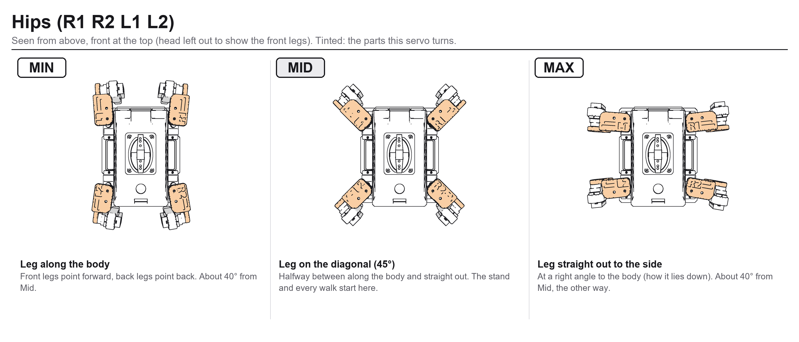

**Knees** (R3 R4 L3 L4) – Min: the foot folded all the way up, the lower leg pointing up close beside the body.
Mid: the foot straight down.
Max: the foot tucked a little in under the body. A knee's Mid is *not* halfway between Min and Max: set it by eye,
don't use **Auto Mid** for knees.

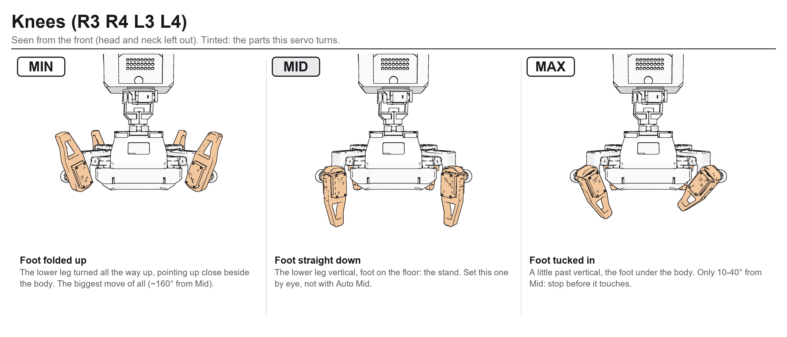

**Head pan** – Min: turned fully to Oreo's right. Mid: straight ahead. Max: turned fully to Oreo's left.

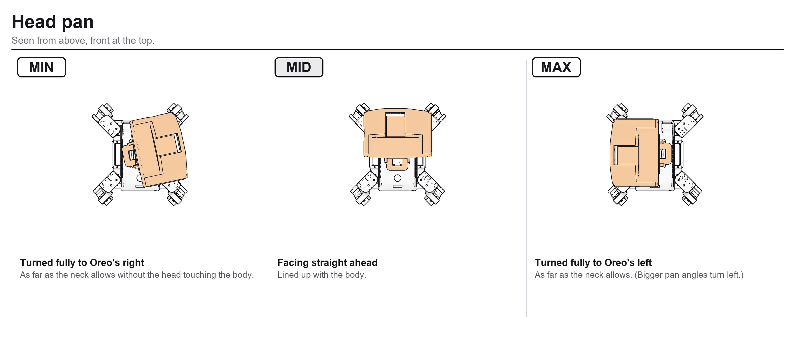

**Head tilt** – Min: looking up, just before the head comes to rest on the neck arms (they stop it about 36° up).
Mid: level. Max: looking down (stop before the head presses on the body).

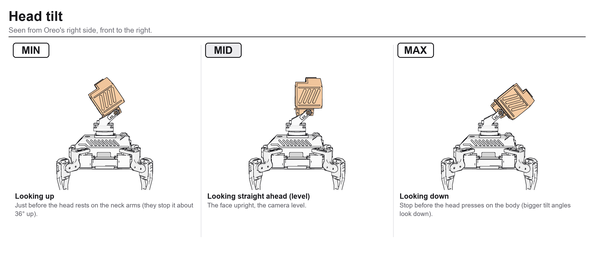

Step by step (robot on a box, legs in the air):

1. Leave the horn screws out (or loose).
2. Press **Set All Mid**: every servo goes to the reference robot's Mid angle.
3. Push each leg and the head onto its servo as close to its **Mid** pose as the spline allows: hips on the
   diagonal, feet straight down, head straight ahead and level. Tighten the horn screws.
4. For each servo: jog it with **±1° / ±10°** until it is exactly in the Mid pose and press **Capture Mid**.
   Then jog it to the Min pose and press **Capture Min**, and to the Max pose and **Capture Max**. Go slowly near
   the ends and stop before a part touches anything.
5. **Save to robot**. **Export Configuration** downloads a copy to keep.

Numbers below 0 are normal: what matters is the pose, not the number. The page's angle is not the servo's own
degree – it is a pulse width (0 = 732 µs, 180 = 2929 µs, the scale of the original Sesame calibrator). An MG90S
answers from about **-19 (500 µs) to about 150 (2560 µs)**; past 150 it sits on its internal end stop and nothing
moves. The reference robot's own values go from -18 to 150, so the knee folds and the hip ends use the servo's
whole travel. If a joint can't reach its drawn Min or Max inside that window, take the horn off and refit it one
spline tooth over (closer to that end), then calibrate that servo again.

The calibration is stored on the robot and survives firmware updates.

## 8. The SD card

Format it FAT32 and copy the repo's [`sd/sesame`](sd/sesame/) folder to its root (or create an empty folder named `sesame`) (the name is kept from the project Oreo grew out of).
The robot adds its own files there (memories, chat logs, face IDs). Files you can add:

| File | What |
|---|---|
| `sesame/wake.tflite` | the "hey Oreo" wake word: copy it from [`sd/sesame/`](sd/sesame/) (see [`sd/README.md`](sd/README.md) for the cutoff and the other model); without it, voice starts from the touch pad or the app |
| `sesame/voices/` | short sound clips for the face's reactions |
| `sesame/timer.wav`, `alarm.wav` | timer and alarm sounds |
| `sesame/personas.txt` | personalities for the conversation |

Everything works without the card; you just lose those extras.

## 9. Developing Oreo

### The code

```
firmware/
  platformio.ini        build settings (PlatformIO; Arduino as an ESP-IDF component)
  sdkconfig.oreo        ESP-IDF settings (PSRAM, network buffers, ...)
  partitions_ota5.csv   two 5 MB app slots for wireless updates
  controller.html       the phone controller (packed into the firmware by pack_html.py)
  calibrate.html        calibration page
  servomap.html         servo mapping page
  src/
    main.cpp            setup, WiFi + web server, the walk engine (gaits, poses), settings, OTA
    servo_map.h         servo roles -> PCA9685 channels (saved on the robot)
    movement-sequences.h  emotes and poses (wave, dance, sit, ...)
    face_engine_v2.h    the face: styles, expressions, blinking, eye movement
    face_scenes.h, face_lib.h, face_logic.h   animated scenes, the face's mood logic
    face_id.h           face detection + recognition on the camera
    gemini.h            voice conversations (Gemini Live over a WebSocket, straight from the robot)
    voice_tools.h       what the robot can do when asked in a conversation (walk, look, timers, ...)
    wakeword.h          on-device wake word (TensorFlow Lite Micro)
    audio.h, music.h, beat.h   speaker, music playback, beat detection for dancing
    desk_*.h            Desk mode: the robot as a desk companion (clock, weather, reactions)
    desk_clock.h        timers, alarms, focus sessions
    life_mode.h         autonomous "living" mode
    oled_ui.h           the chest screen
    talk.h, tls_cert.h  phone mic -> robot speaker over HTTPS, the robot's own certificate
    xlog.h              in-memory activity log (GET /log)
```

### Things to know

* **Two cores, many tasks.** The walk engine runs in the Arduino loop; the camera, face, audio, network and chat
  each have their own FreeRTOS task. Talk between them with the existing flags/queues, not by calling into another
  task's code.
* **Memory.** Big buffers live in PSRAM (`heap_caps_malloc(..., MALLOC_CAP_SPIRAM)`). Internal RAM is tight while
  the camera and a conversation run together – check `GET /status` (`heap`, `minHeap`) after a change.
* **I2C is shared** by the servo board, IMU, ToF and OLED. Use the existing helpers; never block the bus for long.
* **Settings** live in ESP32 Preferences (NVS). Most tuning values are exposed on the controller's settings page
  (each has a name, range and help text in `main.cpp`, search for `PRM(`) – add new ones the same way.
* **Head limits.** Every head move is clamped to the calibrated pan/tilt range; keep it that way, the neck parts
  are small.
* **Web pages** are gzipped into headers. Edit the `.html`, run `python pack_html.py`, build.
* **Logs.** `GET /log` returns the activity log (boot, state changes, problems); the serial monitor shows more.

### Useful endpoints

| URL | What |
|---|---|
| `/` | phone controller |
| `/status` | JSON: battery, mode, heap, sensors |
| `/cmd?go=forward` etc. | movement commands (see the controller's JavaScript for the full list) |
| `/servomap` | servo mapping |
| `/calibrate` | calibration |
| `/log` | activity log |
| `/ota` (POST) | firmware update |

### Contributing

Keep changes small and test them on a robot that is **off the floor** first; only walk it on the floor once the
servos move the way you expect. Describe in a pull request what you changed and how you tested it.

## 10. Troubleshooting

| Problem | Try |
|---|---|
| Board not found when flashing | Another USB-C cable (many are charge-only); BOOT + RST; use the port marked USB |
| Restarts when the legs move | Servo power and logic power must come from separate bucks; check the XL4015 output and the battery |
| A leg moves the wrong way or the wrong leg moves | Servo mapping page, then calibrate |
| Face stays dark | GPIO14 drives both the backlight (EN) and RST – check that joint |
| Battery reading wrong | Settings → Battery: enter the voltage from a multimeter, the scale is computed |
| No voice | https page for the phone mic; Gemini key in the Talk panel; robot on a WiFi with internet |
| Wobbly walking | Recalibrate with the body level; check that the MPU6050 is mounted flat |
