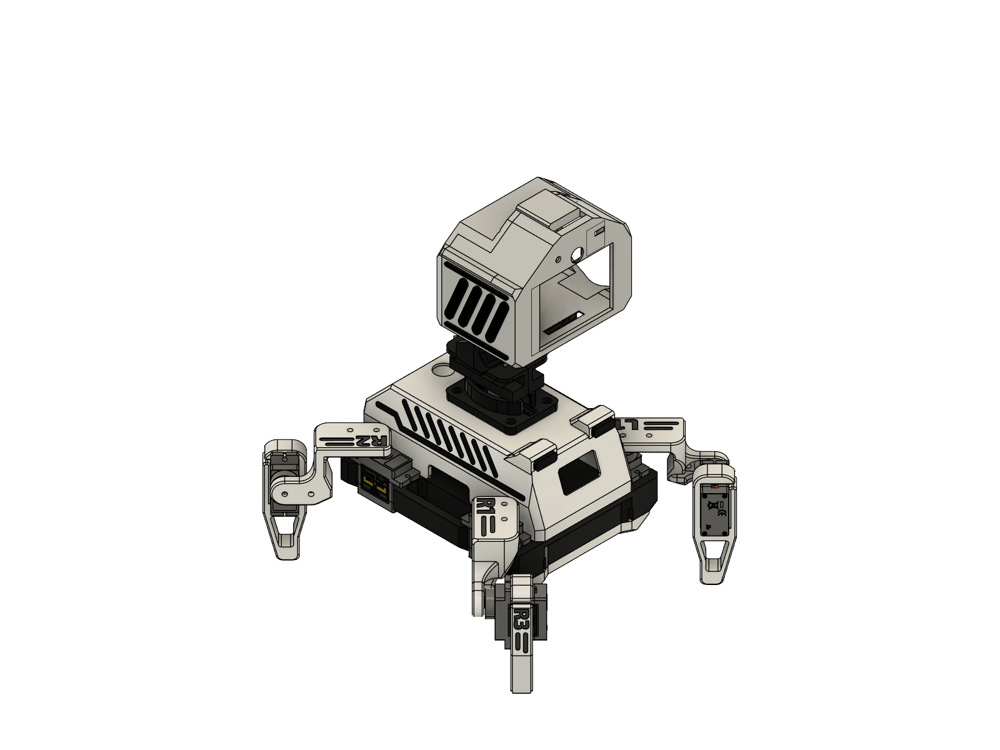
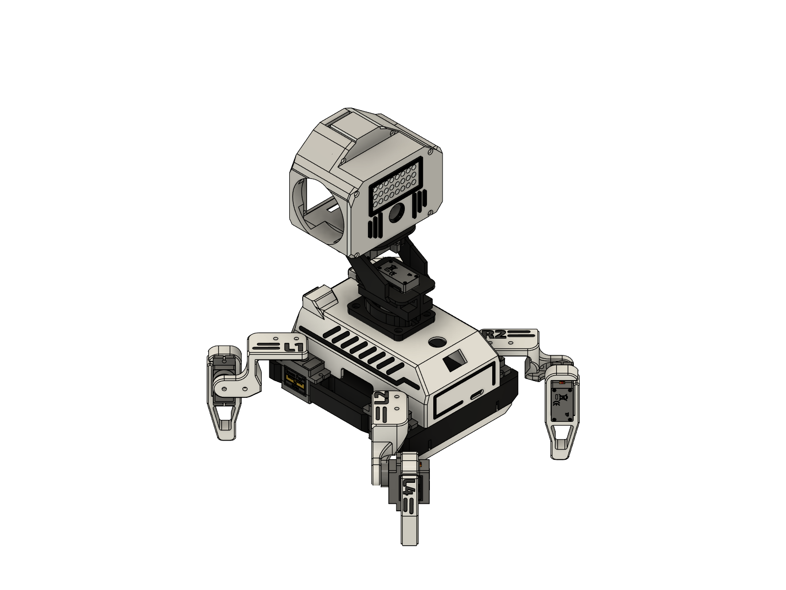

# Oreo

A small four-legged desk robot built around an ESP32-S3 camera board. It walks on eight MG90S servos, looks around
with a pan/tilt head, has an animated face on a 2" display, hears with a MEMS mic, talks through a small speaker,
and can hold real voice conversations.





* **Everything runs on the robot:** walk engine, face, camera face detection and recognition, wake word, web
  controller, and voice chat (Gemini Live, straight from the ESP32 – no server needed).
* **Phone controller** over WiFi: drive, pose, emotes, camera view, talk through the robot, settings.
* **Modes:** remote control, Explore, Desk companion (clock, timers, weather, reactions), Life (autonomous).
* **3D-printed body**: the servos press into their pockets and the shells clip together.

Created by **Sunil J**.

## Start here

**[HANDBOOK.md](HANDBOOK.md)** (or open **HANDBOOK.html** in a browser) – parts, printing, step-by-step assembly drawings, wiring, flashing,
servo mapping and calibration, and a guide to the code.

```
firmware/   PlatformIO project (ESP32-S3, Arduino on ESP-IDF)
gait/       the walk on its own (one header + examples) for improving the gait, PCA9685 or direct servos
hardware/   printable parts: one 3MF with every part, STLs, and the Fusion design (.f3d)
HANDBOOK.md / .html   the build handbook
docs/       drawings, wiring diagram (docs/tools/ has the scripts that make them)
```

## Quick flash

```
cd firmware
pio run -e oreo -t upload
```

Then join the **Oreo** WiFi on your phone and open http://192.168.4.1.

## License

| What | License |
|---|---|
| Firmware (`firmware/`, `gait/`) and scripts | [GPL-3.0-or-later](LICENSE) |
| 3D parts (`hardware/`) | [CERN-OHL-S-2.0](hardware/LICENSE) |
| Handbook (`HANDBOOK.md`, `HANDBOOK.html`) and drawings (`docs/`) | [CC BY-SA 4.0](docs/LICENSE) |

You may build, change and share Oreo, also commercially, as long as you share your changes under the same
licenses and keep the credits. Oreo started from the Apache-2.0 Sesame robot project; see [NOTICE](NOTICE)
for all third-party code and art.
